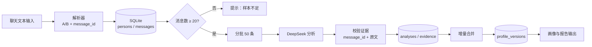
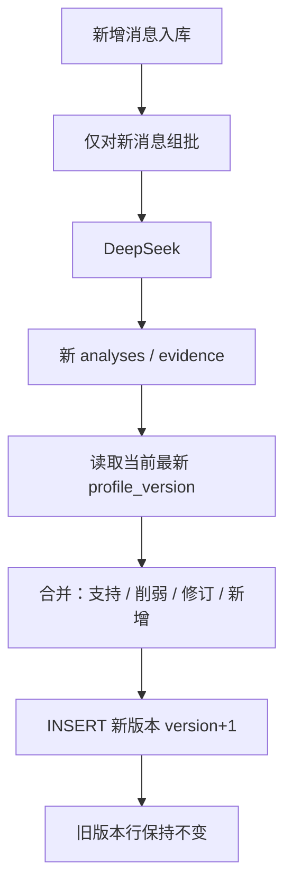
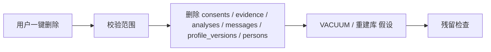

# ARCHITECTURE.md — 系统架构

**项目：** 关系洞察系统 MVP  
**文档状态：** 已冻结 v0.1（2026-09-21 人工确认）

## 0. 已冻结决策（v0.1）

| 项 | 决策 |
|----|------|
| Python | **3.12.4** |
| FastAPI | **同步**（不用 async / 不用 aiosqlite） |
| 第一版文本格式 | 仅 `A: 正文` 与 `B: 正文`（不含时间前缀、不支持微信导出） |
| DeepSeek | 模型名 **`deepseek-chat`**；**OpenAI 兼容接口** |
| 脱敏 | **策略 α**：`messages.body` 存原文；调用模型前正则脱敏；`evidence.quote` 存脱敏后文本 |
| 同意 | UI 勾选框；勾选后写入 **`consents` 表** |

**2026-09-22 追加冻结（拍板）：**

| 项 | 决策 |
|----|------|
| `person_id` 生成 | **冻结**：`uuid5(NAMESPACE_URL, f"person:{conversation_id}:{role}")`（见 §4.1） |
| `conversations` 表 | **确认创建**（宪章五表之外，见 §4.2） |
| 解析错误行 | **导入成功行 + 报错**；仅 `message_id` 冲突才拒绝整批（见 §6） |
| `response_format` | **确认使用** `{"type": "json_object"}`（见 §8） |
| 重试 / 超时 | **确认**：3 次尝试、1.5s 指数退避、60s 超时（见 §8） |
| 脱敏范围 | **不扩展**：MVP 仅 4 类（手机号 / 邮箱 / 身份证 / 银行卡，见 §8） |

**2026-09-22 追加冻结（T-005 轮拍板）：**

| 项 | 决策 |
|----|------|
| `speaker_role` 对 `dyad.*` | **已确认**：恒记真实说话人（不置 NULL，见 §4.5） |
| 批次幂等键 | **冻结**：`(conversation_id, batch_index)`；追加消息后**不重算**既有批次，只分析新增尾批（见 §6） |
| 证据不合法 | **保持**「降级为丢弃 + 记录」，**不**改为整批失败（见 §8） |

**2026-09-22 追加冻结（T-007 轮拍板）：**

| 项 | 决策 |
|----|------|
| 删除范围 | **已确认**：以「按会话删除」（`DELETE /conversations/{id}`）为主；「清空全部本地数据」（`DELETE /data`）只放在设置页，作为危险操作，需二次确认（见 §7） |
| 同意文案 | **已确认**：严格按 `PRIVACY.md` §1.3 文案落地，**不自行发挥**（见 §4.7） |

仍待确认项见各节标注「需人工确认」（如时区展示、删除后是否保留空库结构）。  

---

## 1. 逻辑架构

```
┌─────────────────────────────────────────────────────────┐
│                    Streamlit UI                         │
│  导入 │ A/B 标记 │ 同意 │ 画像卡片 │ 证据 │ 删除 │ 版本 │
└──────────────────────────┬──────────────────────────────┘
                           │ HTTP (MVP)
┌──────────────────────────▼──────────────────────────────┐
│                     FastAPI                             │
│  ingest │ parse │ analyze │ profiles │ consent │ erase  │
└─────────────┬─────────────────────────────┬─────────────┘
              │                             │
              ▼                             ▼
        SQLite (本地)                 DeepSeek API
        persons / messages            分批 JSON 画像
        analyses / evidence
        profile_versions / consents
```

**已确认（v0.1）：** 后端为同步 FastAPI + 标准库 `sqlite3`。  
**假设：** 前端只通过 FastAPI 访问数据库，Streamlit 不直连 SQLite。**需人工确认：** 若为了原型速度允许 Streamlit 直连，T-008 前必须改回单一数据入口，以免删除漏网。

---

## 2. 数据流图

### 2.1 主路径（文本 → 画像）



### 2.2 增量路径



### 2.3 删除路径



---

## 3. 核心模块

| 模块 | 职责 | 对应任务 |
|------|------|----------|
| `parser` | 分行、说话人、时间、message_id | T-002 |
| `db` | 连接、事务、建表 | T-001 |
| `llm.deepseek` | OpenAI 兼容客户端，模型 `deepseek-chat` | T-003 |
| `pipeline.batch` | 50 条一批、样本不足门闩 | T-004 |
| `pipeline.merge` | 画像版本合并 | T-005 |
| `privacy` | 同意、脱敏、删除 | T-007 |
| `ui` | Streamlit | T-006 |

---

## 4. 数据库表结构

**约定：**

- SQLite 文件路径默认 `backend/data/relationinsight.db`（T-001 落地；仓库根 `data/` 不使用）。  
- 时间一律 ISO-8601 UTC 字符串（**假设**；epoch 不用）。**需人工确认**若需改时区展示。  
- `message_id` 在库内主键唯一。  
- 运行时 Python **3.12.4**。

### 4.1 `persons`

| 列名 | 类型 | 约束 | 说明 |
|------|------|------|------|
| id | TEXT | PK | 人物 ID（UUID） |
| conversation_id | TEXT | NOT NULL | 所属会话 |
| role | TEXT | NOT NULL | `A` 或 `B` |
| display_label | TEXT | | 使用者填写的称呼，避免存真实姓名（见 PRIVACY.md） |
| created_at | TEXT | NOT NULL | |

**假设：** 一个 `conversation` 恰好两人。群聊拒绝导入。

**已冻结（2026-09-22）`person_id` 生成方式：**

```python
person_id = str(uuid.uuid5(uuid.NAMESPACE_URL, f"person:{conversation_id}:{role}"))
```

- 与 §6 的 `message_id` 同族：`NAMESPACE_URL` + 确定性字符串，不含随机成分，可复现。
- `role` 仅 `A` / `B`（大写）；`conversation_id` 不做任何规范化（不 `strip`、不改大小写）。
- 同一 `(conversation_id, role)` 必得同一 `person_id`：重复导入或重建库都不会产生重复人物行。
- `display_label` 与 `person_id` 无关，可随时改，不影响证据链。

**已确认（2026-09-22）：** 单独建 `conversations` 表，见 §4.2。

### 4.2 `conversations`（已确认创建 2026-09-22，宪章五表之外）

| 列名 | 类型 | 约束 | 说明 |
|------|------|------|------|
| id | TEXT | PK | |
| title | TEXT | | 用户起的会话名 |
| created_at | TEXT | NOT NULL | |
| status | TEXT | NOT NULL DEFAULT `active` | `active` / `deleted`（CHECK 约束） |

**已确认（2026-09-22 拍板）：创建该表。** 理由：T-007 一键删除需要一张「会话根」作为级联起点；否则 `conversation_id` 无主，删除范围无法表达。

落地位置：`backend/schema.sql`（`CREATE TABLE conversations` + 索引 `idx_conversations_status`）、`backend/db.py` 的 `REQUIRED_TABLES`。

实现与原草案的差异：

- SQL 中 `status` 为 `TEXT NOT NULL DEFAULT 'active' CHECK (status IN ('active','deleted'))`，比本表草案更严（禁止空值与域外取值）。
- 本表当前**无人写入**：`conversations` 行的创建属 API 层（`POST /conversations`，T-007/T-008 接线）；T-002 导入器只使用调用方传入的 `conversation_id` 字符串，不隐式建行。
- 故「有 `messages` 但无 `conversations` 行」在当前版本是正常状态，不是数据损坏。

**仍待人工确认：** 删除时物理删行还是仅置 `status='deleted'`（T-007 范围）。

### 4.3 `messages`

| 列名 | 类型 | 约束 | 说明 |
|------|------|------|------|
| message_id | TEXT | PK | 稳定 ID |
| conversation_id | TEXT | NOT NULL | |
| person_id | TEXT | FK → persons.id | 说话人 |
| seq | INTEGER | NOT NULL | 导入顺序，从 0 或 1 |
| sent_at | TEXT | NULL | 解析到的时间 |
| body | TEXT | NOT NULL | **原文**（策略 α：本地不脱敏） |
| source_line | INTEGER | | 源文件行号 |
| created_at | TEXT | NOT NULL | |

### 4.4 `analyses`

| 列名 | 类型 | 约束 | 说明 |
|------|------|------|------|
| id | TEXT | PK | |
| conversation_id | TEXT | NOT NULL | |
| batch_index | INTEGER | NOT NULL | 第几批，从 0 |
| message_id_from | TEXT | | 本批起 |
| message_id_to | TEXT | | 本批止 |
| seq_from | INTEGER | NOT NULL | |
| seq_to | INTEGER | NOT NULL | |
| model | TEXT | NOT NULL | 实际模型名 |
| prompt_version | TEXT | NOT NULL | 提示词版本 |
| result_json | TEXT | NOT NULL | 批次画像 JSON |
| created_at | TEXT | NOT NULL | |

### 4.5 `evidence`

| 列名 | 类型 | 约束 | 说明 |
|------|------|------|------|
| id | TEXT | PK | |
| analysis_id | TEXT | FK → analyses.id | |
| conversation_id | TEXT | NOT NULL | |
| claim_key | TEXT | NOT NULL | 对应结论键，如 `A.interruption` |
| message_id | TEXT | FK → messages.message_id | |
| quote | TEXT | NOT NULL | **脱敏后**摘录（策略 α）；报告展示 quote，核对原文用 `messages.body` |
| speaker_role | TEXT | | A/B |
| created_at | TEXT | NOT NULL | |

**已确认（v0.1）：** 策略 α。校验：`quote` 须能对应到该 `message_id` 的原文经同一套正则脱敏后的子串或全文（允许空白规范化）。禁止无 ID 的改写句单独作为证据。界面点证据时应同时能打开本地原文。

**T-004 实现约定（2026-09-22）：** `speaker_role` 恒记录该条证据消息（`message_id`）的**真实说话人**，`dyad.*` 结论的证据也不例外（不置 NULL）。理由：UI 点开证据时可直接显示「谁说的」；「该结论不专属于某人」这层语义已由 `claim_key` 前缀 `dyad.` 表达。**已确认（2026-09-22，T-005 轮拍板）：** 以上读法成立——`speaker_role` 对 `dyad.*` 证据同样写**真实说话人 A/B**，**不置 NULL**（取消原「需人工确认」标注；本节原草案只写了「A/B」、未规定 dyad 情形，现补明）。

### 4.6 `profile_versions`

| 列名 | 类型 | 约束 | 说明 |
|------|------|------|------|
| id | TEXT | PK | |
| conversation_id | TEXT | NOT NULL | |
| version | INTEGER | NOT NULL | 从 1 递增 |
| snapshot_json | TEXT | NOT NULL | 该版本完整画像 |
| changelog_json | TEXT | | 相对上一版的变更 |
| message_count | INTEGER | NOT NULL | 该版本覆盖的消息总数 |
| created_at | TEXT | NOT NULL | |
| UNIQUE | (conversation_id, version) | | |

**禁止**对已有 `(conversation_id, version)` 做内容 UPDATE。修正 = 新 version。

### 4.7 `consents`（已确认：必做）

| 列名 | 类型 | 约束 | 说明 |
|------|------|------|------|
| id | TEXT | PK | |
| conversation_id | TEXT | NOT NULL | |
| granted | INTEGER | NOT NULL | 0/1 |
| scope | TEXT | | 如 `self_and_other_agreed` |
| note | TEXT | | 不写聊天原文 |
| created_at | TEXT | NOT NULL | |
| revoked_at | TEXT | NULL | |

**已确认（v0.1）：** 同意来自 UI 勾选框；勾选后插入本表（`granted=1`）。

**已确认（2026-09-22，T-007 轮拍板）：** 同意文案**严格按 `PRIVACY.md` §1.3 落地，不自行发挥**。实现上以 `backend/privacy.py` 的 `CONSENT_STATEMENT`（及版本号 `CONSENT_STATEMENT_VERSION`）为**唯一来源**；前端直接引用该常量，不复制改写文案，避免两处漂移。

**落库内容仅限 `PRIVACY.md` §1.2 允许的四项：** 时间（`created_at`）/ 会话 ID（`conversation_id`）/ 同意范围（`scope`，枚举 `both_parties_informed` / `self_only`）/ 同意书文案版本号（写入 `note`，形如 `statement_version=v0.1`）。**禁止**写入聊天原文、真实姓名、证件号。

**有效同意判定：** `granted=1` **且** `revoked_at IS NULL`（`privacy.has_valid_consent()`）；无有效同意时分析入口一律 `4xx`（`403 no_consent`），前端「开始分析」按钮保持禁用。

**撤回 / 删除策略（按「删行」实现）：** 撤回同意只写 `revoked_at`（保留行以便回看同意历史）；删除会话或清空全库时，该范围内的 `consents` 行**随事务一并删除**（PRIVACY §2.1 的「删除」分支），删除动作本身只留**无原文审计**（时间 + 范围 + 各表行数，见 §7）。

### 4.8 `corrections`（可修正，建议）

| 列名 | 类型 | 约束 | 说明 |
|------|------|------|------|
| id | TEXT | PK | |
| conversation_id | TEXT | NOT NULL | |
| claim_key | TEXT | | |
| profile_version | INTEGER | | 针对哪一版 |
| user_note | TEXT | | 异议说明 |
| created_at | TEXT | NOT NULL | |

MVP 若裁剪，T-005 仍必须版本化；行内修正可放到 v1.1。**需人工确认。**

---

## 5. 批次 JSON 画像（契约草稿）

**假设** 单批 `result_json` 结构如下。T-003/T-004 实现前 **需人工确认** 字段名冻结。

```json
{
  "schema_version": "1.0",
  "persons": {
    "A": {
      "tendencies": [
        {
          "claim_key": "A.request_style",
          "statement": "提出请求时较少给对方选择余地。",
          "confidence": 0.62,
          "sample_size": 8,
          "evidence_message_ids": ["msg_..."]
        }
      ]
    },
    "B": { "tendencies": [] }
  },
  "dyad": {
    "tendencies": []
  },
  "warnings": []
}
```

系统提示必须包含：禁止诊断标签、禁止操控建议、每条 `statement` 必须带已有 `message_id`。  
发给模型的消息正文为脱敏后文本，与 `evidence.quote` 一致（策略 α）。

---

## 6. `message_id` 生成（已冻结 2026-09-22：方案 A）

**算法（唯一实现方式，T-002 起生效）：**

```python
import uuid

message_id = str(uuid.uuid5(uuid.NAMESPACE_URL, f"{conversation_id}:{seq}"))
```

- `conversation_id`：会话标识字符串；参与拼接时不做任何规范化（不 `strip`、不改大小写）。
- `seq`：**会话内的全局序号**（不是「本段文本内的序号」）：从 0 开始、按导入顺序递增（整数）。
  追加导入时 `seq` 的起点由导入端给出，见下方「追加导入自动续号」。
- 同一 `(conversation_id, seq)` 必须永远得到同一 `message_id`：算法可复现，不含随机成分。
- 原「方案 B（sha256 截断）」**废弃**，不得实现。

**重复导入策略（已冻结）：拒绝整批。**

- 写入 `messages` 前先对全批 `message_id` 做存在性检查；只要有一个已存在，**整批不写入**（不做部分导入、不做静默跳过）。
- 冲突必须在错误报告中列出冲突的 `message_id` 及其来源行号，供使用者改 `conversation_id` 或另起会话。
- 同一 `conversation_id` 下 `seq` 唯一，故 `seq` 冲突与 `message_id` 冲突等价。

**追加导入自动续号（2026-09-23 补冻结；T-008 必须项 5 缺陷修复）。**

- `message_id` 算法**不变**（仍是上面的方案 A）。改的是 `seq` 的**语义**：`seq` 是「会话内的全局序号」，
  不再是「本段文本内的序号」。
- 导入端写库前先取偏移量：

  ```sql
  SELECT COALESCE(MAX(seq), -1) + 1 FROM messages WHERE conversation_id = ?
  ```

  并以该值（`seq_offset`）作为本批 `seq` 的起点。空会话 / 首次导入时 `seq_offset = 0`，
  与首版行为**完全一致**；**追加**导入时自然续号（如已有 seq 0–49，则新批从 50 起），
  不再与既有 `message_id` 相撞。
- **冲突检测只在「偏移后仍冲突」时才触发**：偏移后仍撞上既有行（外部写入、显式指定了错误起点等）
  → 仍按方案 A **拒绝整批**并列出冲突 `message_id` 与来源行号。**方案 A 的语义不变。**
- 已知且接受的推论：把**同一段文本**原样再导入一次，不再报 `409`，而是被当作新消息续号追加
  （内容重复但 `seq` 合法）。**内容级去重不在 MVP 范围内**，列入 v1.1 遗留。
- 实现落点：`parser.parse_chat(text, conversation_id, *, seq_offset=0)`、
  `parser.import_chat(text, conversation_id, *, seq_offset=0, ...)`；`backend/main.py::import_messages()`
  负责读取 `seq_offset` 并保持「先偏移、后检测冲突」的顺序。

**已冻结（2026-09-22）：** `person_id` = `uuid5(NAMESPACE_URL, f"person:{conversation_id}:{role}")`（见 §4.1）；`conversations` 表创建（见 §4.2）。

**两条策略不要混淆（均已冻结）：**

| 情形 | 策略 | 理由 |
|------|------|------|
| 文本中有解析不出的行（非 `A: ` / `B: `） | **导入成功行 + 报错**：可解析的行照常写入；错误列表带行号与原因 | 用户可只修正那几行再导入，不必整批重来 |
| 批内出现已存在的 `message_id` | **拒绝整批**：一个都不写，列出冲突 ID 与来源行号 | 半截导入会破坏 `seq` 连续性，使「第 N 批」的切片边界不再可信 |

**已冻结（2026-09-22，T-005 轮拍板）：批次幂等键 = `batch_index`；会话追加消息后不重算既有批次。**

- 批次身份 = `(conversation_id, batch_index)`；`analysis_id = uuid5(NAMESPACE_URL, f"analysis:{conversation_id}:{batch_index}")`，确定性可复现。
- 会话**追加**消息后，已分析过的批次**不重算**（`batch_index=0` 永远是原来那 50 条），只分析新出现的**尾批**。
- 推论（已知且接受）：不足 50 条的**余数批**会随追加「原地长大」（如 60 → 80 条时报 `batch_index=1` 已存在 → 跳过），该批 `message_id_to` 与样本量停留在首次分析时的快照；历史 `analyses` 行不因此改写。
- 理由：维持 `analyses` / `evidence` 与历史 `profile_versions` 的**只增不改**语义——重算会让旧版本快照所引用的结论失去对应批次。
- **T-006 UI 约定（2026-09-22 拍板，维持「原地长大」现状）：** 前端顶部必须常显「当前覆盖消息数」（`snapshot_json.message_count`）与「最新画像版本号」（`snapshot.version`），使用户能看出追加的消息尚未进入画像——不重算、不自动补批次。

**仍待人工确认：** `conversation_id` 由谁分配（当前由调用方传入字符串；`POST /conversations` 未实现，属 T-007/T-008）。

---

## 7. API 草图（MVP）

| 方法 | 路径 | 说明 |
|------|------|------|
| GET | `/health` | 健康检查 |
| POST | `/conversations` | 创建会话 |
| POST | `/conversations/{id}/messages:import` | 导入解析 |
| PATCH | `/messages/{id}/speaker` | 改 A/B |
| POST | `/conversations/{id}/consent` | 同意 |
| POST | `/conversations/{id}/analyze` | 触发批次+合并 |
| GET | `/conversations/{id}/profile` | 最新画像 |
| GET | `/conversations/{id}/profile/versions` | 版本列表 |
| GET | `/conversations/{id}/evidence` | 证据 |
| DELETE | `/conversations/{id}` | 一键删除该会话 |
| DELETE | `/data` | **清空本机全部数据**（危险操作，只放在设置页；`?confirm=true` 二次确认） |

**已确认（2026-09-22，T-007 轮拍板）：** 删除**以「按会话删除」为主**——`DELETE /conversations/{id}`，UI 主入口「删除本会话」；**「清空全部本地数据」**——`DELETE /data`——**只放在设置页**，作为**危险操作**，**必须二次确认**（勾选「我理解不可恢复」+ 再次点击按钮）后才允许执行。

**T-007 实现约定：**

- 两个删除接口都要求显式二次确认参数（`?confirm=true`）；缺失一律 `400 confirmation_required`，**不做**「无参数即删除」的默认行为。
- 删除在**单事务**内按外键安全顺序执行：`evidence` → `analyses` → `profile_versions` → `messages` → `persons` → `consents` → `conversations`；提交后执行 `VACUUM` 并清理 `-wal` / `-shm` / `-journal` 临时文件，降低页内残留。
- 残留检查：删除后对 db 文件（含临时文件）做**字节级检索**，确认已删消息的原文片段 **0 命中**；检查结果只报告「文件名 + 命中数」，**不回显**命中内容。
- 每次删除返回**无原文回执**：`deleted_at`（UTC 时间）、范围（会话 ID 或 `all_data`）、各表删除行数、是否 `VACUUM`、残留检查结论；回执与审计日志**逐字不含** `body` / `quote` / 会话标题等原文。
- 同意闸门：一切分析入口（如 `POST /conversations/{id}/analyze`）先校验有效同意，无同意时 `403`，且**不得**触碰分批管道与模型客户端。

---

## 8. 安全与配置

| 项 | 约定 |
|----|------|
| Python | 3.12.4 |
| FastAPI | 同步路由与同步 `sqlite3` |
| 模型 | `deepseek-chat`，OpenAI 兼容；`base_url` 默认 `https://api.deepseek.com`（可用 `DEEPSEEK_BASE_URL` 覆盖） |
| JSON 约束 | **已确认（2026-09-22）**：请求带 `response_format={"type": "json_object"}`；服务端若不支持，400 归一为 `bad_response`，**不做**自动降级 |
| 重试 | **已确认（2026-09-22）**：最多 **3** 次尝试（首次 + 2 次重试），退避 **1.5s 指数**（1.5 → 3.0s）；仅对 429 / 5xx / 超时 / 连接失败重试，401 立即失败不重试 |
| 超时 | **已确认（2026-09-22）**：单次请求 **60s** |
| API Key | 仅环境变量 `DEEPSEEK_API_KEY`；不进日志、不进异常文本、不进仓库 |
| 脱敏范围 | **已确认（2026-09-22）不扩展**：MVP 仅 4 类正则——手机号、邮箱、身份证号、银行卡号（策略 α）。QQ 号 / 微信号 / 详细地址 / 姓名 / 单位名暂不处理；若要扩展，在 T-007 的 `privacy` 模块统一，避免两处正则漂移 |
| 脱敏时机 | 只在**调用模型前**对 message 文本脱敏；`messages.body` 始终存原文；`evidence.quote` 存脱敏后文本 |
| 证据不合法 | **已确认（2026-09-22，T-005 轮）保持「降级为丢弃 + 记录」**：模型给出的 `message_id` 不存在 / 越界 / 编造时，丢弃该条证据并在 `warnings` 留痕，**不**改为整批失败；结论若因此无证据则整条丢弃（一次调用拿到完整报告，见 T-004） |
| 绑定 | FastAPI 默认 `127.0.0.1`（**假设**，防局域网误暴露） |
| 日志 | 默认 info；body 明文不进日志，只打 `message_id` 与条数 |

---

## 9. 修订记录

| 版本 | 日期 | 说明 |
|------|------|------|
| 0.1 | 2026-09-21 | 启动初稿 |
| 0.1-frozen | 2026-09-21 | 人工确认：Py3.11、同步 FastAPI、A/B 行格式、deepseek-chat、脱敏 α、consents 勾选 |
| 0.2 | 2026-09-22 | Python 基线改为 3.12.4（与实测 venv 一致）；message_id 冻结为方案 A（uuid5） |
| 0.3 | 2026-09-22 | 拍板落地：person_id 生成方式冻结（§4.1）；conversations 建表（§4.2）；区分「解析错误行」与「message_id 冲突」两条策略（§6）；response_format / 重试 / 超时确认（§8）；脱敏范围不扩展（§8）；补 §4.5 speaker_role 读法 |
| 0.4 | 2026-09-22 | T-005 轮拍板冻结：§4.5 取消「需人工确认」——`speaker_role` 对 `dyad.*` 恒记真实说话人；§6 批次幂等键 = `batch_index`、追加消息后不重算既有批次、只分析新增尾批；§8 证据不合法保持「降级为丢弃 + 记录」 |
| 0.5 | 2026-09-22 | T-006 轮拍板：余数批「原地长大」维持现状；新增 UI 约定——前端顶部常显当前覆盖消息数与最新画像版本号（§6） |
| 0.6 | 2026-09-22 | T-007 轮拍板：① 删除以「按会话删除」为主，「清空全部本地数据」为设置页危险操作 + 二次确认（§0 / §7）；② 同意文案严格按 `PRIVACY.md` §1.3 落地、不自行发挥（§0 / §4.7）；补 T-007 实现约定（删除顺序、二次确认参数、`VACUUM`、残留检查、无原文回执、同意闸门） |
| 0.7 | 2026-09-23 | **§6 补冻结「追加导入自动续号」**（T-008 必须项 5 缺陷修复）：`message_id` 算法与「重复导入拒绝整批」语义均不变，仅把 `seq` 语义明确为**会话内全局序号**，导入端取 `MAX(seq)+1` 作为起点、先偏移后检测冲突；同一段文本原样再导入不再报冲突（内容级去重留 v1.1） |
