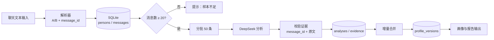
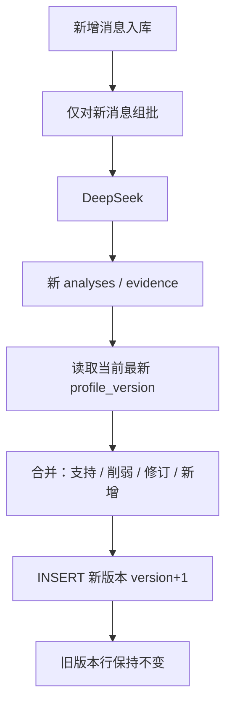
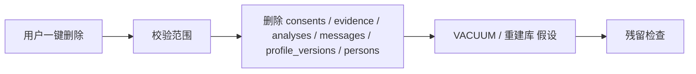

# ARCHITECTURE.md — 系统架构

**项目：** 关系洞察系统 MVP  
**文档状态：** 已冻结 v0.1（2026-09-21 人工确认）

## 0. 已冻结决策（v0.1）

| 项 | 决策 |
|----|------|
| Python | **3.12.4** |
| FastAPI | **同步**（不用 async / 不用 aiosqlite） |
| 第一版文本格式 | 仅 `A: 正文` 与 `B: 正文`（不含时间前缀、不支持微信导出） |
| DeepSeek | 模型名 **`deepseek-chat`**；**OpenAI 兼容接口** |
| 脱敏 | **策略 α**：`messages.body` 存原文；调用模型前正则脱敏；`evidence.quote` 存脱敏后文本 |
| 同意 | UI 勾选框；勾选后写入 **`consents` 表** |

仍待确认项见各节标注「需人工确认」（如是否建 `conversations` 表、`person_id` 生成方式、全局清空等）。  

---

## 1. 逻辑架构

```
┌─────────────────────────────────────────────────────────┐
│                    Streamlit UI                         │
│  导入 │ A/B 标记 │ 同意 │ 画像卡片 │ 证据 │ 删除 │ 版本 │
└──────────────────────────┬──────────────────────────────┘
                           │ HTTP (MVP)
┌──────────────────────────▼──────────────────────────────┐
│                     FastAPI                             │
│  ingest │ parse │ analyze │ profiles │ consent │ erase  │
└─────────────┬─────────────────────────────┬─────────────┘
              │                             │
              ▼                             ▼
        SQLite (本地)                 DeepSeek API
        persons / messages            分批 JSON 画像
        analyses / evidence
        profile_versions / consents
```

**已确认（v0.1）：** 后端为同步 FastAPI + 标准库 `sqlite3`。  
**假设：** 前端只通过 FastAPI 访问数据库，Streamlit 不直连 SQLite。**需人工确认：** 若为了原型速度允许 Streamlit 直连，T-008 前必须改回单一数据入口，以免删除漏网。

---

## 2. 数据流图

### 2.1 主路径（文本 → 画像）



### 2.2 增量路径



### 2.3 删除路径



---

## 3. 核心模块

| 模块 | 职责 | 对应任务 |
|------|------|----------|
| `parser` | 分行、说话人、时间、message_id | T-002 |
| `db` | 连接、事务、建表 | T-001 |
| `llm.deepseek` | OpenAI 兼容客户端，模型 `deepseek-chat` | T-003 |
| `pipeline.batch` | 50 条一批、样本不足门闩 | T-004 |
| `pipeline.merge` | 画像版本合并 | T-005 |
| `privacy` | 同意、脱敏、删除 | T-007 |
| `ui` | Streamlit | T-006 |

---

## 4. 数据库表结构

**约定：**

- SQLite 文件路径默认 `backend/data/relationinsight.db`（T-001 落地；仓库根 `data/` 不使用）。  
- 时间一律 ISO-8601 UTC 字符串（**假设**；epoch 不用）。**需人工确认**若需改时区展示。  
- `message_id` 在库内主键唯一。  
- 运行时 Python **3.12.4**。

### 4.1 `persons`

| 列名 | 类型 | 约束 | 说明 |
|------|------|------|------|
| id | TEXT | PK | 人物 ID（UUID） |
| conversation_id | TEXT | NOT NULL | 所属会话 |
| role | TEXT | NOT NULL | `A` 或 `B` |
| display_label | TEXT | | 使用者填写的称呼，避免存真实姓名（见 PRIVACY.md） |
| created_at | TEXT | NOT NULL | |

**假设：** 一个 `conversation` 恰好两人。群聊拒绝导入。

**需人工确认：** 是否单独建 `conversations` 表。建议 MVP 增加如下表，避免 conversation_id 无主。

### 4.2 `conversations`（建议，宪章五表之外）

| 列名 | 类型 | 约束 | 说明 |
|------|------|------|------|
| id | TEXT | PK | |
| title | TEXT | | 用户起的会话名 |
| created_at | TEXT | NOT NULL | |
| status | TEXT | | `active` / `deleted` |

若为减少表数量，可将会话信息塞进 `persons.conversation_id` 无主外键。**需人工确认。**

### 4.3 `messages`

| 列名 | 类型 | 约束 | 说明 |
|------|------|------|------|
| message_id | TEXT | PK | 稳定 ID |
| conversation_id | TEXT | NOT NULL | |
| person_id | TEXT | FK → persons.id | 说话人 |
| seq | INTEGER | NOT NULL | 导入顺序，从 0 或 1 |
| sent_at | TEXT | NULL | 解析到的时间 |
| body | TEXT | NOT NULL | **原文**（策略 α：本地不脱敏） |
| source_line | INTEGER | | 源文件行号 |
| created_at | TEXT | NOT NULL | |

### 4.4 `analyses`

| 列名 | 类型 | 约束 | 说明 |
|------|------|------|------|
| id | TEXT | PK | |
| conversation_id | TEXT | NOT NULL | |
| batch_index | INTEGER | NOT NULL | 第几批，从 0 |
| message_id_from | TEXT | | 本批起 |
| message_id_to | TEXT | | 本批止 |
| seq_from | INTEGER | NOT NULL | |
| seq_to | INTEGER | NOT NULL | |
| model | TEXT | NOT NULL | 实际模型名 |
| prompt_version | TEXT | NOT NULL | 提示词版本 |
| result_json | TEXT | NOT NULL | 批次画像 JSON |
| created_at | TEXT | NOT NULL | |

### 4.5 `evidence`

| 列名 | 类型 | 约束 | 说明 |
|------|------|------|------|
| id | TEXT | PK | |
| analysis_id | TEXT | FK → analyses.id | |
| conversation_id | TEXT | NOT NULL | |
| claim_key | TEXT | NOT NULL | 对应结论键，如 `A.interruption` |
| message_id | TEXT | FK → messages.message_id | |
| quote | TEXT | NOT NULL | **脱敏后**摘录（策略 α）；报告展示 quote，核对原文用 `messages.body` |
| speaker_role | TEXT | | A/B |
| created_at | TEXT | NOT NULL | |

**已确认（v0.1）：** 策略 α。校验：`quote` 须能对应到该 `message_id` 的原文经同一套正则脱敏后的子串或全文（允许空白规范化）。禁止无 ID 的改写句单独作为证据。界面点证据时应同时能打开本地原文。

### 4.6 `profile_versions`

| 列名 | 类型 | 约束 | 说明 |
|------|------|------|------|
| id | TEXT | PK | |
| conversation_id | TEXT | NOT NULL | |
| version | INTEGER | NOT NULL | 从 1 递增 |
| snapshot_json | TEXT | NOT NULL | 该版本完整画像 |
| changelog_json | TEXT | | 相对上一版的变更 |
| message_count | INTEGER | NOT NULL | 该版本覆盖的消息总数 |
| created_at | TEXT | NOT NULL | |
| UNIQUE | (conversation_id, version) | | |

**禁止**对已有 `(conversation_id, version)` 做内容 UPDATE。修正 = 新 version。

### 4.7 `consents`（已确认：必做）

| 列名 | 类型 | 约束 | 说明 |
|------|------|------|------|
| id | TEXT | PK | |
| conversation_id | TEXT | NOT NULL | |
| granted | INTEGER | NOT NULL | 0/1 |
| scope | TEXT | | 如 `self_and_other_agreed` |
| note | TEXT | | 不写聊天原文 |
| created_at | TEXT | NOT NULL | |
| revoked_at | TEXT | NULL | |

**已确认（v0.1）：** 同意来自 UI 勾选框；勾选后插入本表（`granted=1`）。撤回/删除策略仍 **需人工确认**（删行 vs 无原文审计）。

### 4.8 `corrections`（可修正，建议）

| 列名 | 类型 | 约束 | 说明 |
|------|------|------|------|
| id | TEXT | PK | |
| conversation_id | TEXT | NOT NULL | |
| claim_key | TEXT | | |
| profile_version | INTEGER | | 针对哪一版 |
| user_note | TEXT | | 异议说明 |
| created_at | TEXT | NOT NULL | |

MVP 若裁剪，T-005 仍必须版本化；行内修正可放到 v1.1。**需人工确认。**

---

## 5. 批次 JSON 画像（契约草稿）

**假设** 单批 `result_json` 结构如下。T-003/T-004 实现前 **需人工确认** 字段名冻结。

```json
{
  "schema_version": "1.0",
  "persons": {
    "A": {
      "tendencies": [
        {
          "claim_key": "A.request_style",
          "statement": "提出请求时较少给对方选择余地。",
          "confidence": 0.62,
          "sample_size": 8,
          "evidence_message_ids": ["msg_..."]
        }
      ]
    },
    "B": { "tendencies": [] }
  },
  "dyad": {
    "tendencies": []
  },
  "warnings": []
}
```

系统提示必须包含：禁止诊断标签、禁止操控建议、每条 `statement` 必须带已有 `message_id`。  
发给模型的消息正文为脱敏后文本，与 `evidence.quote` 一致（策略 α）。

---

## 6. `message_id` 生成（已冻结 2026-09-22：方案 A）

**算法（唯一实现方式，T-002 起生效）：**

```python
import uuid

message_id = str(uuid.uuid5(uuid.NAMESPACE_URL, f"{conversation_id}:{seq}"))
```

- `conversation_id`：会话标识字符串；参与拼接时不做任何规范化（不 `strip`、不改大小写）。
- `seq`：本会话内的导入顺序，**从 0 开始**、按导入顺序递增（整数）。
- 同一 `(conversation_id, seq)` 必须永远得到同一 `message_id`：算法可复现，不含随机成分。
- 原「方案 B（sha256 截断）」**废弃**，不得实现。

**重复导入策略（已冻结）：拒绝整批。**

- 写入 `messages` 前先对全批 `message_id` 做存在性检查；只要有一个已存在，**整批不写入**（不做部分导入、不做静默跳过）。
- 冲突必须在错误报告中列出冲突的 `message_id` 及其来源行号，供使用者改 `conversation_id` 或另起会话。
- 同一 `conversation_id` 下 `seq` 唯一，故 `seq` 冲突与 `message_id` 冲突等价。

**需人工确认（尚未冻结）：** `person_id` 的生成方式（T-002 暂用同一 `uuid5` 配 `f"person:{conversation_id}:{role}"`）；`conversation_id` 由谁分配、是否单独建 `conversations` 表（见 4.2）。

---

## 7. API 草图（MVP）

| 方法 | 路径 | 说明 |
|------|------|------|
| GET | `/health` | 健康检查 |
| POST | `/conversations` | 创建会话 |
| POST | `/conversations/{id}/messages:import` | 导入解析 |
| PATCH | `/messages/{id}/speaker` | 改 A/B |
| POST | `/conversations/{id}/consent` | 同意 |
| POST | `/conversations/{id}/analyze` | 触发批次+合并 |
| GET | `/conversations/{id}/profile` | 最新画像 |
| GET | `/conversations/{id}/profile/versions` | 版本列表 |
| GET | `/conversations/{id}/evidence` | 证据 |
| DELETE | `/conversations/{id}` | 一键删除该会话 |
| DELETE | `/data` | 清空本地全部（危险，需二次确认） |

**需人工确认：** 是否实现全局清空。

---

## 8. 安全与配置

| 项 | 约定 |
|----|------|
| Python | 3.12.4 |
| FastAPI | 同步路由与同步 `sqlite3` |
| 模型 | `deepseek-chat`，OpenAI 兼容（`base_url` **假设** `https://api.deepseek.com`） |
| API Key | 仅环境变量 `DEEPSEEK_API_KEY` |
| 绑定 | FastAPI 默认 `127.0.0.1`（**假设**，防局域网误暴露） |
| 日志 | 默认 info；body 明文不进日志 |

---

## 9. 修订记录

| 版本 | 日期 | 说明 |
|------|------|------|
| 0.1 | 2026-09-21 | 启动初稿 |
| 0.1-frozen | 2026-09-21 | 人工确认：Py3.11、同步 FastAPI、A/B 行格式、deepseek-chat、脱敏 α、consents 勾选 |
| 0.2 | 2026-09-22 | Python 基线改为 3.12.4（与实测 venv 一致）；message_id 冻结为方案 A（uuid5） |
